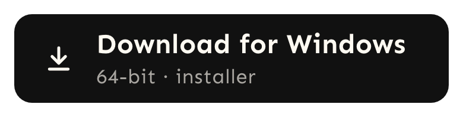
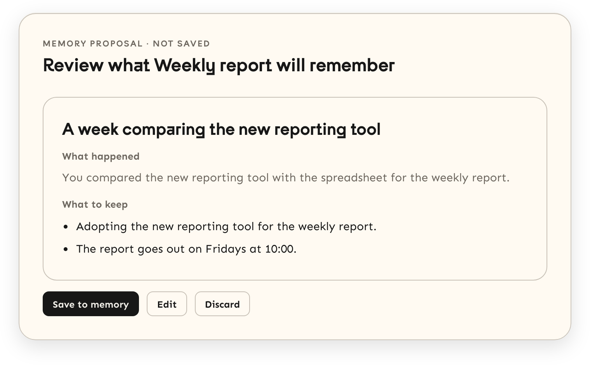
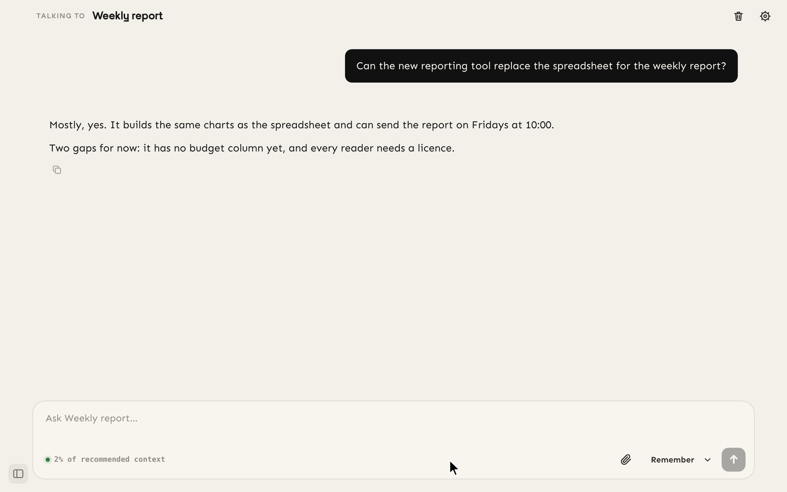
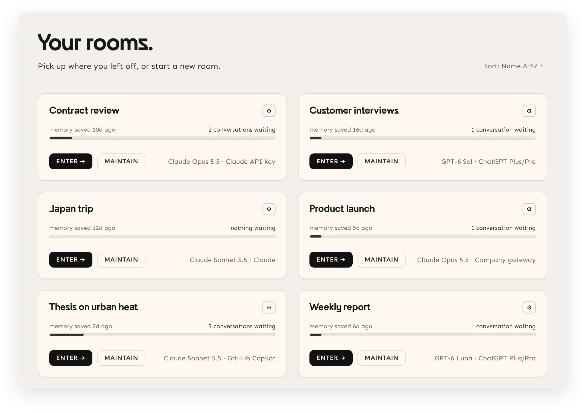
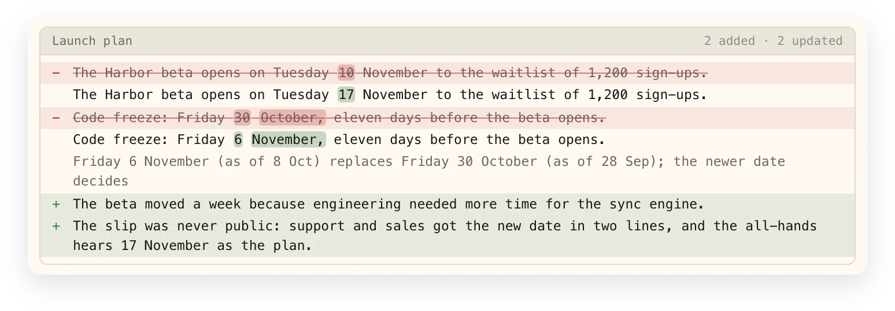

<p align="center">
  <picture>
    <source media="(prefers-color-scheme: dark)" srcset="apps/web-ui/public/brand/exxperts-logo-negative.png">
    
  </picture>
</p>

<p align="center">A free, open-source desktop app for getting work done with AI</p>

<p align="center">
  <a href="https://github.com/EXXETA/exxperts/releases/latest"></a>
  <a href="LICENSE"></a>
</p>

<h1 align="center">Most AI apps learn about you on their&nbsp;own.<br>exxperts learns with&nbsp;you.</h1>

<p align="center">
  An AI knows what you told it. Only you know why it matters and what has changed since. So what it remembers is a guess, and every later answer builds on it.
</p>

<p align="center">
  <b>exxperts shows you that guess first, so you can fix it before anything is saved.</b>
</p>

<p align="center">
  <a href="https://github.com/EXXETA/exxperts/releases/latest/download/exxperts-desktop-mac-arm64.dmg"><picture><source media="(prefers-color-scheme: dark)" srcset=".github/readme/download-mac-dark.png"></picture></a>
  <a href="https://github.com/EXXETA/exxperts/releases/latest/download/exxperts-setup-win-x64.exe"><picture><source media="(prefers-color-scheme: dark)" srcset=".github/readme/download-windows-dark.png"></picture></a>
</p>

<p align="center"><sub>Also as a <a href="https://github.com/EXXETA/exxperts/releases/latest/download/exxperts-desktop-win-x64.zip">portable Windows .zip</a> · <a href="#install">Linux, Intel Mac and the terminal</a> · <a href="https://github.com/EXXETA/exxperts/releases/latest">All downloads</a></sub></p>

<p align="center">
  <picture>
    <source media="(max-width: 600px) and (prefers-color-scheme: dark)" srcset=".github/readme/hero-phone-dark.webp">
    <source media="(max-width: 600px)" srcset=".github/readme/hero-phone-light.webp">
    <source media="(prefers-color-scheme: dark)" srcset=".github/readme/hero-dark.webp">
    
  </picture>
</p>

<p align="center">The memory is a plain file on your computer. Each answer sends the conversation and the room's memory to the AI you choose, as any AI app does.</p>

<p align="center"><sub>One room per project or topic · Sign in with ChatGPT, Claude or GitHub Copilot, or use an API key or your company's gateway</sub></p>

## AI can read your chats, not your mind

An AI learns from what you type: what comes up often, what you asked last, what you spent an hour on. It can't see the meeting where you changed your mind. Say you spend a week asking about a new reporting tool because you are deciding whether to adopt it. Then, in a meeting, you decide against it. An AI that learns on its own now counts that tool as part of your work, and its next answers build on it. At best, other apps let you find and delete it later, if you notice.

In exxperts you see it before it is kept. When you press **Remember**, the draft says "Adopting the new reporting tool". You change it to "Decided against the new reporting tool" and save. A conversation you never remember leaves nothing in memory.

<p align="center">
  <picture>
    <source media="(prefers-color-scheme: dark)" srcset=".github/readme/remember-dark.webp">
    
  </picture>
</p>

## How it works

1. **Work in a room.** Ask, write and research as you would in any AI chat.
2. **Press Remember.** The room drafts what is worth keeping from the conversation. You edit the draft, save it or discard it.
3. **The next conversation knows it.** The room starts every conversation with its saved notes.

When enough has piled up, the room's card says it is time to sort what you saved into short notes by topic, so the memory stays small and easy to read. You start it from the card. Once 20 saved conversations are waiting to be sorted, the room needs that sorting before you start a new one. The room shows every change before saving, and asks when a new note may disagree with an older one: keep both, or replace the older one.

## Quick answers

- **Is it free?** Yes, and it needs no account with us. You pay only your AI provider, if it charges you.
- **Which AI does it use?** The one you already have. Sign in with a ChatGPT Plus or Pro plan, a Claude Pro or Max plan, or GitHub Copilot (GitHub's plan, not Microsoft 365 Copilot). Or use an API key, a code you create on the provider's website and pay for by use: Claude, OpenAI, Gemini, Mistral, OpenRouter and others work. Or connect your company's gateway. [All the ways in](#bring-your-own-ai).
- **Do I have to check every conversation?** Only the ones you keep. When a conversation is done, **Remember** shows the draft, and **Forget** deletes the conversation instead. Once you trust a room, a switch can skip the draft.
- **Memory or chat history: what is kept?** A conversation you remember is kept on your computer: the notes you confirm go into memory, and the whole conversation stays there to read and search. A conversation you forget is deleted for good.
- **How is it different from memory in ChatGPT or Claude?** They save memory on their own and show it afterwards, where you can edit or delete it, and both can keep a separate memory per project. exxperts shows you what it would keep before keeping it, stores the memory as a file on your computer, and works with whichever AI you use.
- **Does one project's memory reach another?** Only when you ask. Each room has its own memory. Mention another room with @ and the answer comes from that room's memory.
- **Can I use it with confidential work?** Yes, with an AI provider your company allows for that data. Your messages and the room's memory go to that provider, under its terms for the way you connect, including whether it may train on them. What changes: you decide what the memory holds, it is stored on your computer, each project can have a room of its own, and nothing goes to us. [Where your data goes](#where-your-data-goes).
- **Does the memory help?** On a public test of long chat histories, a room answering from its memory did as well as the same model reading the whole history, using under a quarter of the tokens to answer each question. [How it was measured](#measured).
- **Who makes it?** [Exxeta](https://exxeta.com/en/exxperts). The people behind it are named [at the end of this page](#license-and-credits).

## One room per project or topic

<p align="center">
  <picture>
    <source media="(prefers-color-scheme: dark)" srcset=".github/readme/rooms-dark.webp">
    
  </picture>
</p>

A room is an assistant for one thing you keep coming back to: a project, a product, a course you teach, a thesis, a trip. It has its own instructions, memory, folder and choice of AI model, and its memory holds only what you confirmed in that room. It is a personal app: rooms are not shared with a team.

## Memory you can check

<p align="center">
  <picture>
    <source media="(prefers-color-scheme: dark)" srcset=".github/readme/history-dark.webp">
    
  </picture>
</p>

- **History.** Every change to a room's memory, newest first, with what was added, updated or archived. Every note shows the day it was saved.
- **Look back.** The growth chart has a point for every save. Click one to read the memory as it was then.
- **Undo.** Take back the room's last sorting or tidy-up, as long as nothing has changed the memory since.
- **Edit by hand.** Add, edit, pin, move or delete any note. A deleted note goes to the archive, where you can restore it or delete it for good.
- **Tidy up with AI.** The room can make the notes shorter and clearer and move what is finished to the archive. You see every change first.

<details>
<summary><b>For developers: the memory is a Markdown file</b></summary>

A room's memory lives in one file, `~/.exxperts/app/personalized-agents/<room>/L1b/current.md`, and any editor can open it. Its notes are read with every message, within the room's memory budget; the archive and the conversations you remembered are searched only when a question needs them. Two notes, as they are on disk:

```markdown
### Launch plan

<!-- e: id=m-0002 kind=fact saved=2026-10-01 from=RC-0001 learned=2026-09-26 -->
- Alex owns the Harbor beta launch, end to end; Sam leads engineering for the beta.

<!-- e: id=m-0004 kind=fact saved=2026-10-01 from=RC-0001 learned=2026-09-26 -->
- Everyone on the waitlist gets in on the same day, so nobody hears about it second-hand.
```

Compared with a `CLAUDE.md` or rules file you keep by hand, a room drafts each update and shows it to you before saving. It does not feed Claude Code or Cursor; they can only read the file like any other. How the pieces fit: [How exxperts works](docs/how-exxperts-works.md) and [Memory](docs/memory.md).

</details>

## What a room can do

- **Search the web** through your AI plan's own search, DuckDuckGo, or a search engine you run yourself, and read the pages it finds.
- **Work in a folder you choose.** *Full access* works with files like you do; *Bounded* keeps the room inside that folder. Either way, the room's file tools refuse common secret and key files, saved logins and the app's own data. Commands are off until you turn them on in Full access; the room then asks before each one, unless you tell it to run without asking.
- **Write documents and slide decks** as web pages, with charts and diagrams, in the background while you keep talking.
- **Use your tools.** Connect GitHub, Notion, Linear, Atlassian, Google Drive, Gmail, Microsoft 365 and more, or any MCP server, and switch each one on per room.
- **Learn skills.** Import skills from GitHub, including Anthropic's. A skill that changes waits for your review before a room uses it again.
- **Run on a schedule.** Daily, weekly or one-time prompts, while the app is running.

<details>
<summary>And three more</summary>

- **HiveMind** answers one question from the memory of all your rooms, or the ones you pick, and names the room each fact came from.
- **Remote access** opens your rooms on your phone over your own private Tailscale network. It is off until you turn it on.
- **The Wallet** shows what each room and model spends, measured on your computer.

</details>

## Bring your own AI

| Way in | What you need |
|---|---|
| **ChatGPT** | A ChatGPT Plus or Pro plan. Sign in from the app. |
| **Claude** | A Claude Pro or Max plan. Sign in from the app. |
| **GitHub Copilot** | A Copilot plan. Sign in from the app. Its models include Claude where your plan has them. |
| **API key** | A key for Claude, OpenAI, Google Gemini, Mistral, OpenRouter, DeepSeek, xAI, Groq or about twenty more. |
| **Your gateway** | Any OpenAI-compatible address, such as a company LiteLLM or vLLM gateway. The app loads its models for you. |

Each room picks its own model in **Room settings, Model**: one for conversations and one for memory work. You can change the model between answers, even in the middle of a conversation, and the room keeps its memory. When an answer fails, the room says why in plain words, and **Try again** picks up where it stopped. [Provider setup](docs/provider-setup.md).

Local model servers such as Ollama or LM Studio offer the same kind of address as a gateway, but we have not tested them with exxperts yet.

## Where your data goes

**Stored on your computer:** your rooms, their memory and conversations, the files they make, and your sign-ins, in `~/.exxperts` in your home folder. You can move that folder, for example into a synced folder, in **Settings, Profiles**. exxperts has no account, no server of its own, no analytics and no crash reports. Nothing goes to us.

**Sent out, only to do the work:**

- **To the AI provider you chose:** the conversation, the room's instructions and memory, and the files it reads. This happens with every answer, when you press Remember, and when the room sorts or tidies its memory.
- **To a search engine and the sites it finds:** search terms go to your AI plan's own search, DuckDuckGo or a search engine you run, and the room opens the pages it needs. Search is on at first. To turn it off, choose **Off** in **Settings, Web search** and untick **Provider search where available**; a gateway model still searches while web search is ticked for it in **Settings, AI setup**. Rooms can still open links you give them.
- **To a connector's server:** when you add a connector or sign in to it, and when a room that has it switched on uses it.
- **To GitHub:** the desktop app checks for a new version at launch and every six hours. An update downloads only when you choose **Install and restart**.

<details>
<summary><b>For IT and security teams</b></summary>

- **Local only.** The app's server listens only on this computer (127.0.0.1) and every request needs a sign-in token. Remote access, off by default, adds the person's own paired devices over their Tailscale network. [SECURITY.md](SECURITY.md) has the threat model.
- **Sign-ins and keys.** AI sign-ins and API keys are kept in `~/.exxperts/agent/auth.json`, connector sign-ins in `~/.exxperts/agent/mcp-oauth/`, and connector tokens in `~/.exxperts/agent/mcp.json`; none are in the system keychain. On Mac and Linux only the person's account can read `auth.json` (file mode 600); on Windows it has the user folder's permissions.
- **Off by default:** running commands, saving memory without the previews, and remote access. Connectors and skills are switched on per room.
- **Files.** Even with Full access, the room's file tools refuse a built-in list of secret files and folders, such as `.env` files, keys, `.ssh`, cloud logins and shell startup files, and the app's own data. Commands, when turned on, run only after the person approves each one, unless they switch that room to run them without asking.
- **Every other connection**, besides the list above:
  - Each saved gateway is asked for its model list and prices at start, once a day, and when a model is not found.
  - Sign-ins are refreshed with Anthropic, OpenAI or GitHub as needed. GitHub also serves Copilot's model list, the skills someone browses or imports, and ripgrep when a terminal install has none (the desktop app ships its own).
  - **Health Check** and `exxperts doctor` test whether cdn.sheetjs.com can be reached when a source install lacks spreadsheet support, and reach the person's own search engine if one is set.
  - Docker Hub, only if the local search engine is set up. A terminal install that builds from source downloads its npm packages and a headless Chromium.
  - Pages the person opens in a browser load their own resources.
  - Requests to OpenRouter name exxperts as the app.
- **Signed releases.** The Mac app is signed by Exxeta AG and notarized by Apple. The Windows installer is signed by Exxeta AG. Every release lists SHA-256 checksums and three software bills of materials. The terminal installers check the checksum before unpacking; if it does not match, they do not use that file and build from the GitHub source instead. A vulnerability scan runs every week.
- **Updates** never install by themselves. The desktop app checks GitHub for a new version and shows a notice; the download starts only when the person chooses **Install and restart**, and is checked against the SHA-512 in the release's update file. The portable Windows .zip has no **Install and restart**: its notice opens the download page.
- **Not there yet:** central policy management, a list of allowed providers, a managed install package, and a switch for the update check. Settings are per person.
- **Security reports** go privately to the addresses in [SECURITY.md](SECURITY.md).

</details>

## Install

**The app.** Download it for [Mac with Apple silicon](https://github.com/EXXETA/exxperts/releases/latest/download/exxperts-desktop-mac-arm64.dmg) or [Windows 64-bit](https://github.com/EXXETA/exxperts/releases/latest/download/exxperts-setup-win-x64.exe) (also as a [portable .zip](https://github.com/EXXETA/exxperts/releases/latest/download/exxperts-desktop-win-x64.zip)). The Mac app is signed by Exxeta AG and notarized by Apple, and the Windows installer is signed by Exxeta AG; if Windows shows a SmartScreen notice for a new release, **More info** names that publisher. Then:

1. Open **Settings, AI setup** and sign in. With a ChatGPT Plus or Pro plan or a Claude Pro or Max plan, that is all you need: no API key, no terminal. For Copilot, an API key or a gateway, choose **Add provider**.
2. On Home, create a room and give it a name.
3. Talk to it, then press **Remember** when you are done.

**The terminal**, for Linux and Intel Macs, or to run the app in your browser on Mac or Windows:

```bash
# macOS and Linux
curl -fsSL https://raw.githubusercontent.com/EXXETA/exxperts/main/install.sh | bash
```

```powershell
# Windows (PowerShell)
irm https://raw.githubusercontent.com/EXXETA/exxperts/main/install.ps1 | iex
```

Then run `exxperts web` and the app opens in your browser. Run the same line again to update. `exxperts doctor` checks your install and says how to fix what is missing.

<details>
<summary>Requirements and other systems</summary>

- Ready-made builds for macOS on Apple silicon, Windows x64 and Linux x64. On other systems the same line builds from source, which needs Git and Node.js 20.6 or newer.
- The app and the terminal install share the same rooms and memory in `~/.exxperts`, and one of them runs at a time.
- Running commands in rooms on Windows needs Git for Windows. The [Quickstart](docs/quickstart.md) has the Windows notes and the steps by hand.

</details>

## Measured

- **Memory.** On LongMemEval-S, a public test of long chat histories, a room answered 47 of 50 questions from its memory, using under a quarter of the tokens to answer each question, once its memory was built. The same model reading the whole history answered 41. The model was Claude Sonnet 5. In the test every conversation was saved without a person checking it, so it measures the memory, not the check. [How it was measured](docs/memory.md#how-well-it-works-measured).
- **Tests.** About 320 smoke tests. GitHub runs them on Linux, macOS and Windows for every pull request and every change to main; the 40 or so that need a browser are skipped there.

## Docs and help

- **Start:** [Quickstart](docs/quickstart.md) · [Connect your AI](docs/provider-setup.md) · [How exxperts works](docs/how-exxperts-works.md)
- **Use:** [Memory](docs/memory.md) · [Files and commands](docs/workspace-and-bash.md) · [Connectors](docs/mcp.md) · [Web search](docs/web-search.md) · [Wallet](docs/wallet.md)
- **Trust:** [Security](SECURITY.md) · [What's new](CHANGELOG.md) · [All docs](docs/README.md)

Stuck? Run **Health Check** in the desktop app, or `exxperts doctor`, and open an [issue](https://github.com/EXXETA/exxperts/issues) with what it says.

## Contributing

Bug reports and ideas are welcome in [Issues](https://github.com/EXXETA/exxperts/issues). Before a larger change, open an issue so we can agree on it first. [CONTRIBUTING.md](CONTRIBUTING.md) has the setup and the checks. Please report security issues privately, as [SECURITY.md](SECURITY.md) describes.

If exxperts is useful to you, a star helps others find it. To hear about new versions, choose **Watch**, then **Custom**, then **Releases**.

## License and credits

[Apache 2.0](LICENSE), free for personal and commercial use. exxperts is designed and built by **Borja Odriozola Schick** ([@borcho23](https://github.com/borcho23)) and **Fernando Pastor Alonso** ([@ferpastoralonso](https://github.com/ferpastoralonso)) at [Exxeta](https://exxeta.com). It is built on [Pi](https://github.com/badlogic/pi-mono) by Mario Zechner; the bundled runtime under `runtime/` is derived from Pi (MIT), with its license in [`runtime/LICENSE`](runtime/LICENSE) and the fork described in [`runtime/NOTICE.md`](runtime/NOTICE.md). Connector logos come from [Simple Icons](https://simpleicons.org) (CC0) and belong to their owners.
